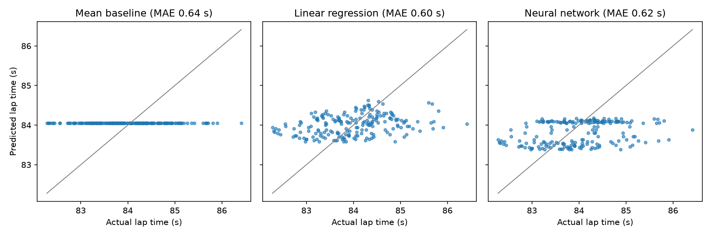
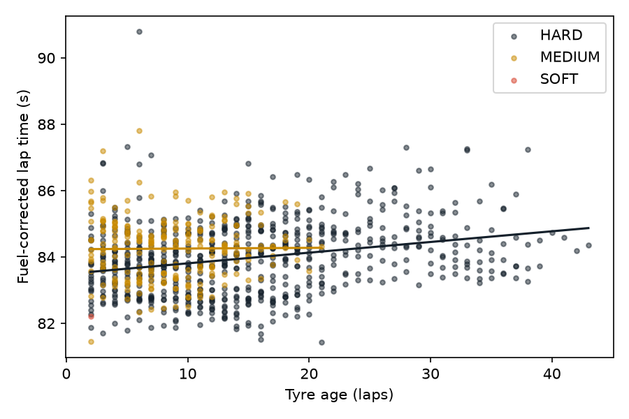

# F1 Tyre Degradation Model

How much slower does an F1 car get as its tyres wear? This project predicts lap time from tyre age and compound using real race data from [tif1](https://tif1.tracinginsights.com/) — timing data generated with FastF1 and published as static files, so no F1TV account is needed — and compares a small neural network against two simpler baselines.

**Stack:** Python, tif1, pandas, scikit-learn, TensorFlow/Keras, matplotlib, pytest.

## Run it

```bash
python -m venv .venv && source .venv/bin/activate
pip install -r requirements.txt
python -m tyremodel --year 2024 --event Monza
python -m pytest
```

Options: `--drivers VER NOR` to use specific drivers, `--target raw` to predict raw lap time instead of the fuel-corrected one, `--seed N`, `--out DIR`. The first run downloads the race data from the tif1 CDN (cached locally by tif1, no account needed).

Results go to `results/`, which is committed so the plots show up on GitHub: `metrics.json`, `predicted_vs_actual.png`, and `degradation_by_compound.png`.

## Method

**Data.** Every lap of one race session (default: 2024 Italian Grand Prix), loaded with tif1 from FastF1-generated timing data.

**Cleaning.** A lap is kept only if all of these hold:
- It is not an in-lap or out-lap (no pit entry or exit time).
- Track status is `1` (green flag, no safety car or yellow).
- The data marks the lap as accurate.
- Lap time, compound, tyre age, and stint are present.
- The compound is soft, medium, or hard.

**Fuel correction.** Cars get faster as fuel burns off, which would hide tyre wear. The default target subtracts 0.03 s for each lap of fuel still to burn. That figure is an approximation and varies by circuit (`FUEL_SECONDS_PER_LAP` in `features.py`).

**Features.** Tyre age in laps and a one-hot compound. With `--target raw`, lap number is added so a model can learn fuel burn itself.

**Split.** 75/25 by stint, so every lap from a given driver's stint lands entirely in train or in test. Laps in a stint are strongly correlated, so a random split by row would leak information into the test set.

**Models.**
1. Mean baseline: always predicts the training average.
2. Linear regression.
3. Neural network: two hidden layers (32 and 16 units, ReLU), Adam, early stopping on a validation slice of the training laps.

All three are scored by mean absolute error (MAE) in seconds on the held-out stints.

## Results

2024 Italian Grand Prix (Monza), fuel-corrected lap time. 728 train laps (37 stints) and 199 test laps (13 stints), split by stint. Values are from `results/metrics.json`.

| Model | MAE (s) |
|---|---|
| Mean baseline | 0.637 |
| Linear regression | 0.600 |
| Neural network | 0.621 |

Per-compound degradation (seconds lost per lap of tyre age): HARD 0.0322, MEDIUM 0.0021. No rate is reported for SOFT — too few clean SOFT laps to fit one.

Linear regression won. The neural network did not beat linear regression (0.621 s vs 0.600 s). With only two features, a straight line is often hard to beat.





## Limitations

- One race, so a few hundred laps at most.
- Track evolution, weather, and traffic are not modelled.
- The fuel correction is a fixed estimate, not measured per car.
- Tyre age is the only wear signal. Driving style and car setup are ignored.
- Results from one circuit should not be generalised to others.

## Tests

`pytest` covers the cleaning rules, fuel correction, feature construction, and the stint-level split, using small synthetic tables. CI runs it on every push.

## Layout

```
tyremodel/
  data.py       download laps with tif1
  features.py   cleaning, fuel correction, features, split
  models.py     baseline, linear regression, neural network
  evaluate.py   MAE, degradation rates, plots
  cli.py        training script
tests/          pytest tests for the data code
```
